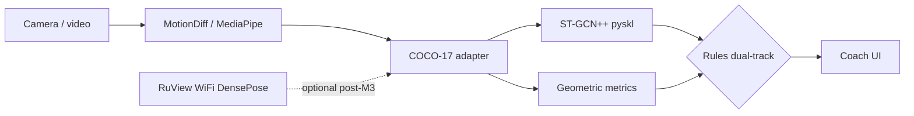

# Architecture notes

v1 scope: youth technical correction, no embodied robot.

Main pipeline (M0 contract):

**Camera / video → MediaPipe (MotionDiff export) → COCO-17 adapter → ST-GCN++ (pyskl) → rules dual-track → coach-ui**

Pose topology and layouts: [`pose_contract.md`](pose_contract.md).

- Solid path = v1 main.
- RuView is **dashed / optional (post-M3)** — not required for M0–M3.
- Dual-track rules: `from: geometric` (angles from COCO-17) vs `from: model` (ST-GCN++ confidence / scores). They are not interchangeable — see `rules/README.md`.

Owned IP in this repo: labels, rules, Coach UI, pose/rules contracts, in-repo adapters. Forks stay external; pin versions in `integrations/`.

## Competition slice

The OpenCV AI Competition 2026 path is shooting-only and is documented separately so this v1 diagram stays the MediaPipe / Render coach: [opencv26/architecture.md](opencv26/architecture.md). That design adds OpenCV 5 DNN pose and AWS. AWS itself is a follow-up; it is not deployed from this file.
