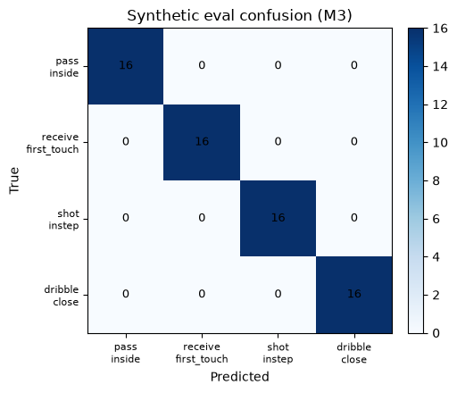

# M3 evaluation — confusion matrix

**Status:** synthetic dataset + ONNX probe eval (not real youth video).

Eval set is synthetic COCO-17 skeletons generated by scripts/generate_synthetic_dataset.py — not real youth video. Numbers measure probe separability of synthetic signatures only.

- **Accuracy:** 100.0% (64 eval clips)
- **Mean predicted confidence:** 0.920
- **Model:** `models/youth_football_probe.onnx`

## Confusion matrix



Rows = true class, columns = predicted. Class order:

0. `pass.inside`
1. `receive.first_touch`
2. `shot.instep`
3. `dribble.close`

```
[[16  0  0  0]
 [ 0 16  0  0]
 [ 0  0 16  0]
 [ 0  0  0 16]]
```

## Per-class

| label_id | precision | recall | f1 | support |
|----------|-----------|--------|----|---------|
| `pass.inside` | 1.000 | 1.000 | 1.000 | 16 |
| `receive.first_touch` | 1.000 | 1.000 | 1.000 | 16 |
| `shot.instep` | 1.000 | 1.000 | 1.000 | 16 |
| `dribble.close` | 1.000 | 1.000 | 1.000 | 16 |

## Regenerate

```bash
pip install -r requirements-m2.txt
pip install matplotlib  # for PNG only
python scripts/generate_synthetic_dataset.py --n-per-class 80
python scripts/eval_confusion.py
```

Optional: retrain the probe on the synthetic train split before eval:

```bash
python scripts/train_linear_probe.py --also-onnx
python scripts/eval_confusion.py
```

Artifacts: `reports/confusion_matrix.json`, `reports/confusion_matrix.png`,
`reports/classification_report.md`.
