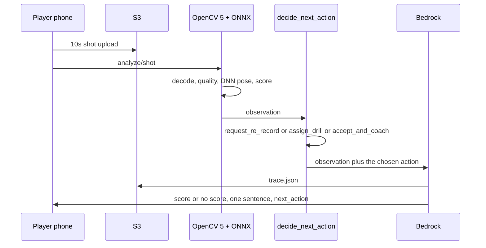

# Agentic loop for a shot

OpenCV 5 decides whether the clip can be trusted and which geometric fault matters. The policy then picks **one** next action. The sentence follows that action. A chat recap of a fixed score is not this loop.

Perceive → decide → act figure: [agent-workflow.png](agent-workflow.png). Bedrock in that figure is deferred.



`decide_next_action` still runs inside `pipeline/shot/scoring.py`. The phone can PUT the clip through the live presign API, and `POST /analyze/shot` can GetObject that key. Bedrock does not write the sentence yet, and the trace is not stored.

## Observation

```json
{
  "quality": {"blur_var": 42.1, "person_frac": 0.08, "pose_ok_frac": 0.12, "pass": false},
  "metrics": {"torso_lean_deg": 31.2, "plant_foot_angle_deg": 88.0},
  "model": {"label_id": "shot.instep", "confidence": 0.61, "score": null},
  "opencv_version": "5.0.0"
}
```

The live response already carries `quality`, `metrics`, `model`, and `opencv`. `agent.trace_s3_key` stays `null` until the trace is stored.

## Policy

```
if not quality.pass: return request_re_record
if torso lean > 25° or plant foot outside 70–110°: return assign_drill
return accept_and_coach
```

| next_action | When | What the player sees |
|-------------|------|----------------------|
| `request_re_record` | Blur, brightness, too few frames, tiny player, low joint confidence | One re-record sentence. No score |
| `assign_drill` | Quality passed and a geometric fault fired | Score, one sentence from `rules.json`, one `drill_id` |
| `accept_and_coach` | Quality passed and no geometric fault | Score and one reinforcement sentence |

Drills: `shot.instep.lean` → `drill.lean_wall`. `shot.instep.plant_foot` → `drill.plant_target`. Two faults still produce one sentence, the larger point penalty.

## Evidence to keep for the report

1. Blurry or tiny player → `request_re_record`, `score: null`
2. Back lean → `assign_drill` / `drill.lean_wall` and the lean sentence only
3. Clean side-view shot → `accept_and_coach` and a score
4. Three S3 `trace.json` files once PR-B writes them
5. Failure cases: occlusion, backlight, player far from the camera

## Not a chatbot

| Does not qualify | Qualifies |
|------------------|-----------|
| Vision always finishes, then an LLM explains the score | Bad picture changes the action to re-record |
| No change of plan | A geometric fault changes the action to a drill |
