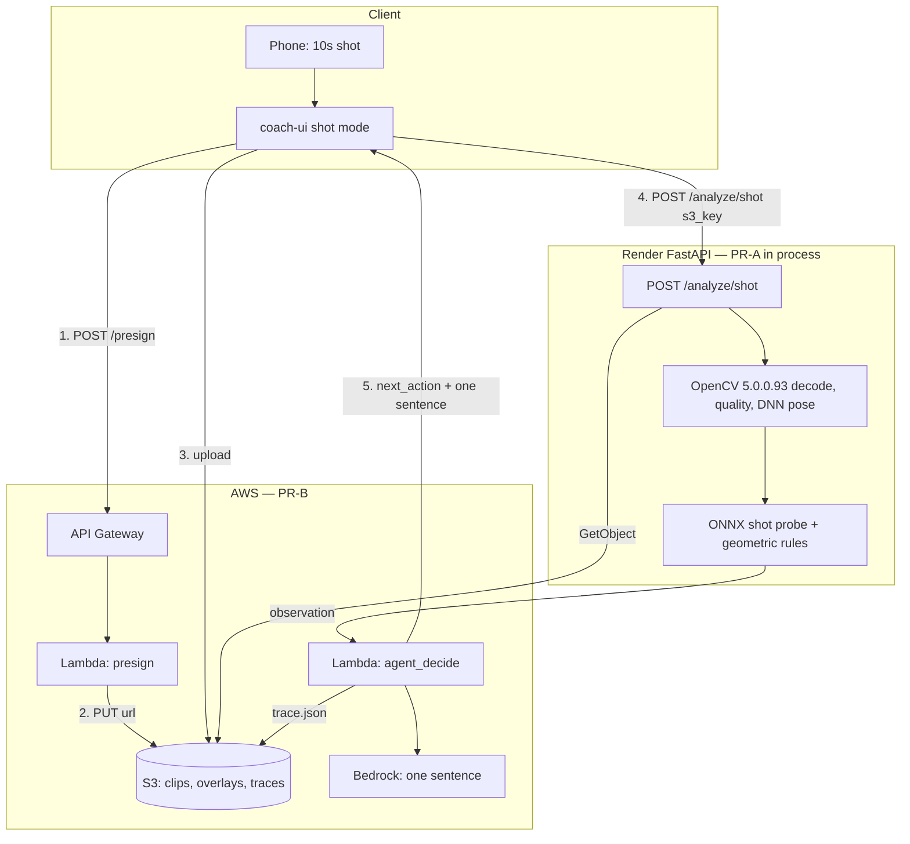

# Shot agent architecture

NATI 哪踢 / ScoutMind youth football. AI Football Coach is the technique-correction slice. The competition demo is **instep shooting only**.

OpenCV 5 does the video work. S3 stores the clip. Render keeps the low-latency API it already serves. Presign and `s3_key` GetObject are wired. Bedrock and the agent Lambda are not. `decide_next_action` still runs in the API.

As-deployed figure: [architecture.png](architecture.png). The report is [opencv26_technical_report.pdf](opencv26_technical_report.pdf).



Keypoints and `POST /analyze/shot/video` still work. Step 5 is `decide_next_action` inside the API. `s3_key` downloads `uploads/…` from `SHOT_BUCKET` and then runs the OpenCV path. On the live image that returns 503 (no boto3 / no OpenCV) instead of pretending to score. Bedrock does not rewrite the sentence. Env and the live presign URL: `docs/deploy_aws.md`.

## Who does what

| Layer | Job |
|-------|-----|
| OpenCV 5 | `VideoCapture`, Laplacian blur, brightness, DNN pose (MoveNet or YOLO-pose ONNX), skeleton overlay |
| Geometry + ONNX probe | Force `shot.instep`. Plant foot and torso lean become 0–100. The probe only nudges the score |
| Agent | `request_re_record`, `assign_drill`, or `accept_and_coach` from those measurements |
| Bedrock | Deferred. It would rewrite the one sentence and would not pick `next_action` |
| S3 | Clip store. Presign is live. The API GetObject path reads `uploads/` only |
| Render | Public API. Deploy image stays on `requirements-deploy.txt` until a second service exists |

## Response the UI should read

```json
{
  "label_id": "shot.instep",
  "score": 72,
  "coaching_zh": "上身后仰过多，容易打飞；微微前倾压球。",
  "agent": {
    "next_action": "assign_drill",
    "drill_id": "drill.lean_wall",
    "reason_codes": ["quality_ok", "torso_lean_high"],
    "policy": "deterministic_v1",
    "trace_s3_key": null
  },
  "opencv": {
    "version": "5.0.0",
    "pose_backend": "dnn_movenet",
    "frames_used": 87,
    "compliant": true,
    "pinned": "5.0.0.93"
  }
}
```

`score` is `null` when `next_action` is `request_re_record`.

## Out of scope

Full ST-GCN++ replacement, COOL/Graviton benchmarks, multi-skill UI, robots, RuView.
