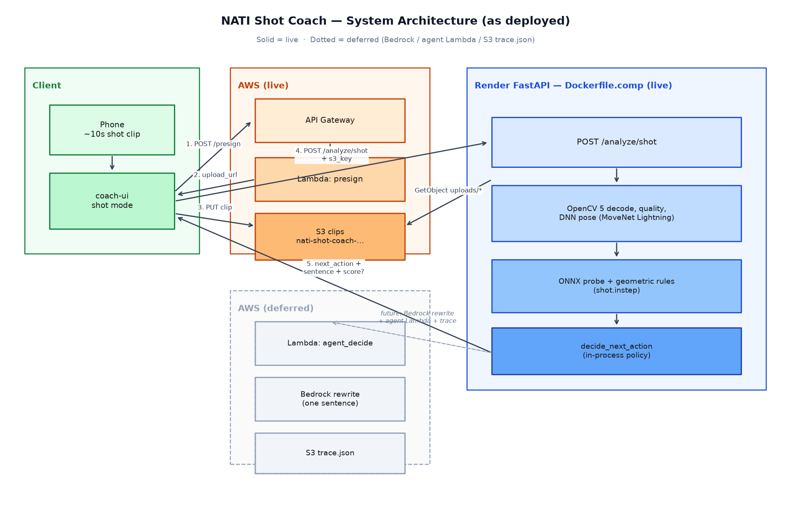
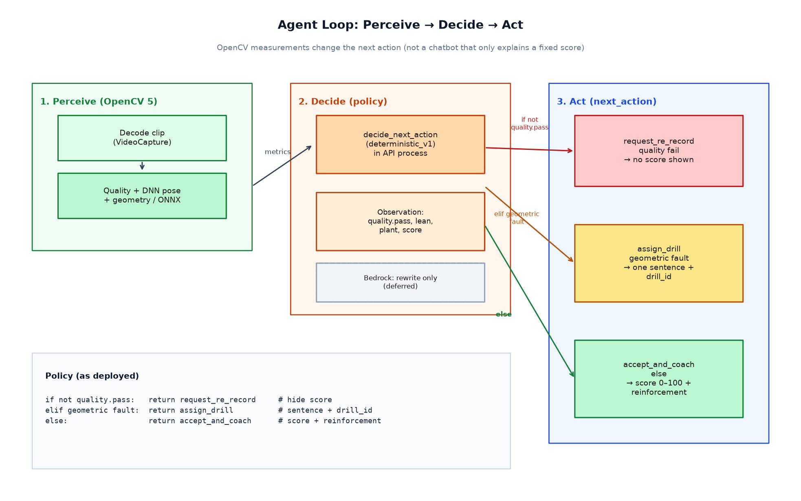

# NATI Shot Coach — OpenCV AI Competition 2026 Technical Report

**Team:** Ruoli Wang ([ReallyWong](https://github.com/ReallyWong))  
**Product:** NATI 哪踢 / ScoutMind (youth football ability assessment)  
**Competition slice:** AI Football Coach — instep shooting only (`shot.instep`)  
**Track intent:** Agentic Vision (perceive → decide → act)  
**Repo:** https://github.com/ReallyWong/ai-football-coach (branch `comp/opencv26-shot-agent`)  
**Live demo:** https://nati-shot-coach-comp.onrender.com  
**Deadline used:** 26 Oct 2026, 11:45pm PDT  

## 1. Problem and users

Youth players get delayed, expensive shooting feedback. Parents and youth coaches need a fast loop: record a short clip, learn whether to re-record or run a drill, and hear **one** actionable sentence.

This entry is deliberately narrow: **instep shooting only**. Passing, first touch, and dribbling remain on the separate fundamentals path (`POST /analyze`) and are not part of the competition claim.

## 2. Related product

AI Football Coach is the on-pitch technique-correction slice of ScoutMind. The competition build is a **compliant OpenCV 5 + AWS** shooting agent on top of that stack, not a replacement of the whole coach product.

## 3. System overview

OpenCV 5 does the video work. AWS S3 stores the clip (presigned upload). Render serves the low-latency FastAPI. The agent policy chooses the next action from OpenCV measurements. Bedrock sentence rewrite and a dedicated agent Lambda are **not deployed yet**; `decide_next_action` currently runs in the API process.



**Figure 1.** As-deployed system topology. Solid boxes are live; dotted boxes (Bedrock rewrite, agent Lambda, `trace.json`) are deferred. See also `docs/opencv26/architecture.md` in the repo.

## 4. OpenCV 5 implementation

Pinned: `opencv-python-headless==5.0.0.93` (`requirements-comp.txt`). Contest image: `Dockerfile.comp` (separate from the production fundamentals image).

| Step | Role |
|------|------|
| `VideoCapture` decode | Substantive video analysis, not a single still |
| Quality gates | Blur, brightness, person size, joint coverage → `request_re_record` when unsafe |
| DNN pose | MoveNet Lightning ONNX via `cv2.dnn` (`ENGINE_NEW`); build-time fetch into `models/pose/` |
| Geometry + probe | Force `shot.instep`; plant foot and torso lean → score 0–100 |
| Overlay | Skeleton for demos / failure inspection |

MediaPipe is fallback only when `AIFC_ALLOW_MP_FALLBACK=1` (not set on the contest service).

Live health (verified 2026-10-22 Asia/Shanghai) reports `pose_model_present: true`, `pose_backend` path MoveNet, and S3 credentials configured.

## 5. AWS deployment

| Component | Status |
|-----------|--------|
| S3 bucket `nati-shot-coach-660008586940` (`ap-southeast-1`) | Live |
| API Gateway + Lambda presign → `{upload_url, s3_key, headers}` | Live: `https://s14hcf6sc0.execute-api.ap-southeast-1.amazonaws.com/presign` |
| `POST /analyze/shot` with `s3_key` → GetObject `uploads/*` | Live on contest Render |
| Bedrock one-sentence rewrite | Deferred |
| Agent Lambda + `trace.json` | Deferred (`agent.trace_s3_key` stays null) |

Presigned upload keeps long-lived upload keys out of the browser. Contest Render env includes `SHOT_BUCKET` and standard AWS credential env vars. IAM notes: `docs/deploy_aws.md`.

Spend intent: keep contest AWS usage under Free-plan credits (~$100). Render Starter (~$7/mo) is billed on Render, not against that pool.

## 6. Agent loop (perceive → decide → act)

Observation comes from OpenCV quality + geometry. The deterministic policy is the agent brain:

```
if not quality.pass: request_re_record     # no score shown
elif geometric fault: assign_drill         # one sentence + drill_id
else: accept_and_coach                      # score + reinforcement
```



**Figure 2.** Agent loop (perceive → decide → act). Quality failure hides the score; a geometric fault assigns a drill; otherwise the clip is accepted with a score and reinforcement sentence.

This is **not** a chatbot that only explains a fixed score: the OpenCV measurement **changes** the next action (re-record vs drill vs accept). That is the Agentic Vision claim for this entry.

When Bedrock lands, it may rewrite the sentence from the same observation; it will **not** choose `next_action`.

## 7. Score and coaching

- Score: 0–100 from plant foot and torso lean, with a small ONNX confidence prior.
- One Chinese coaching sentence for faults (from `rules.json` / drill copy).
- UI: `request_re_record` hides the score; `assign_drill` surfaces `drill_id` (`drill.lean_wall`, `drill.plant_target`).

Example shape (illustrative):

```json
{
  "label_id": "shot.instep",
  "score": 72,
  "coaching_zh": "上身后仰过多，容易打飞；微微前倾压球。",
  "agent": {
    "next_action": "assign_drill",
    "drill_id": "drill.lean_wall",
    "policy": "deterministic_v1",
    "trace_s3_key": null
  },
  "opencv": {
    "version": "5.0.0",
    "pose_backend": "dnn_movenet",
    "compliant": true,
    "pinned": "5.0.0.93"
  }
}
```

## 8. Evaluation and failure cases

Evidence sources in-repo: `reports/` (probe confusion context), quality-gate behavior on short clips, live e2e (presign → S3 PUT → `/analyze/shot`).

Observed / expected failure modes:

- Tiny or incomplete clips → `request_re_record`, `score: null` (correct refusal).
- Side light / occlusion → many clips fail quality gates.
- Free-tier Render memory may struggle on large (~6MB+) clips; demo uses short recordings or Starter if upgraded.
- Synthetic ONNX probe is a stand-in prior, not a large labeled shooting dataset or full ST-GCN++.

## 9. Limits and responsible use

- 2D pose has no ball-speed or goal truth. The score is a **technique heuristic**, not a scout rating.
- A coaching sentence can still be wrong; a human coach should review before treating it as instruction.
- Youth data: short clips for coaching feedback; do not treat outputs as medical or talent judgments.
- Production fundamentals Render image stays on `requirements-deploy.txt` (no OpenCV/torch). Contest claims apply to the **comp** service only.

## 10. Reproducibility

```bash
pip install -r requirements-comp.txt
# optional: models/pose/README.md / scripts/fetch_movenet_lightning.py
bash scripts/run_analyze_api.sh
curl -s http://127.0.0.1:8000/analyze/shot \
  -H 'Content-Type: application/json' \
  -d '{"pose_path":"fixtures/demo_shot_instep_pose.json"}'
```

Contest deploy: `Dockerfile.comp`, env `SHOT_BUCKET=nati-shot-coach-660008586940`, region `ap-southeast-1`. Details: `docs/opencv26/README.md`, `docs/deploy_aws.md`.

## 11. Submission package status (as of draft)

| Requirement | Status |
|-------------|--------|
| Technical report | PDF: `opencv26_technical_report.pdf` |
| Judge-accessible repo | Public GitHub; tag `opencv26-submit` pending |
| Pinned deps + build/deploy/test | `requirements-comp.txt`, docs above |
| Architecture diagram | `architecture.png` + `agent-workflow.png` (embedded); also `docs/opencv26/architecture.md` |
| Working endpoint | https://nati-shot-coach-comp.onrender.com |
| ≤5 min video | **Outstanding (team)** |
| Evaluation evidence | Partial (`reports/`, live refusal paths); expand traces optional |
| COOL / Graviton | Optional; not blocking |

## Appendix

- Agent workflow draft: `docs/opencv26/agent-workflow.md`
- Checklist: `docs/opencv26/submission-checklist.md`
- Demo scripts: `docs/demo_script.en.md`, `docs/demo_script.zh.md`
